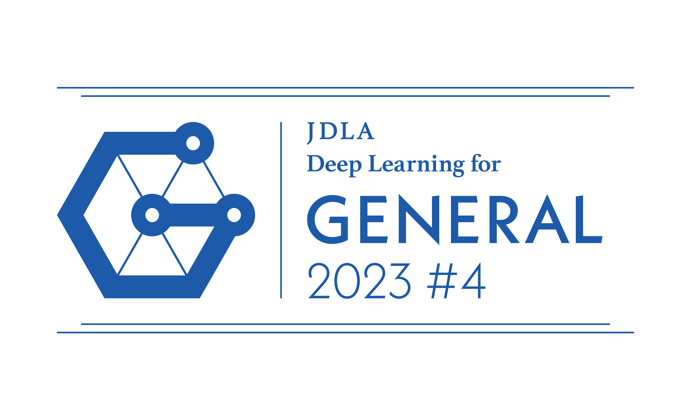
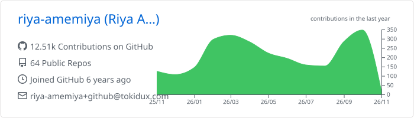
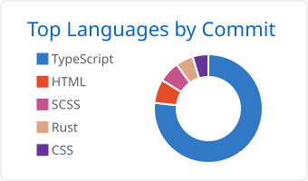
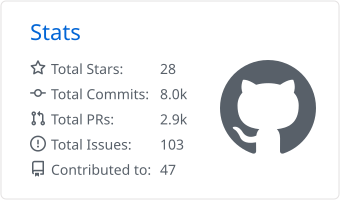

 

 
[日本語](./README-ja.md) | **English**
 

## 👋 About
 
Hi, I'm Riya. 
I work as a Platform Engineer at Dinii Inc. 
As a V8 contributor, I mainly work on speeding up `Array.prototype` builtins. 
I also help run conferences as a TSKaigi staff member, write articles on Zenn, and speak at meetups and conferences.
 
## ⚙️ V8 Contributions
 
I work on performance improvements and bug fixes for V8 builtins. 
The background and benchmark results of each optimization are written up on Zenn (in Japanese).
 
| Target | Change | Result | Article |
| --- | --- | --- | --- |
| `Array.prototype.flat` | Added a Torque fast path | Up to ~5x faster | [Zenn](https://zenn.dev/dinii/articles/675d47a6c21c83) |
| `Array.prototype.flat` | Added bulk copy to the fast path | A further ~5x faster | [Zenn](https://zenn.dev/dinii/articles/e12fbacc8e761c) |
| `Array.prototype.copyWithin` | Added a Torque fast path | Up to ~450x faster | [Zenn](https://zenn.dev/dinii/articles/a272b7c3b60ab8) |
| `Array.prototype.fill` | Skipped per-element stores for Smi and double values | Up to ~7x faster | [Zenn](https://zenn.dev/dinii/articles/5b8edc7856c25b) |
| `Array.prototype.lastIndexOf` | Specialized by ElementsKind | Up to ~26000x faster | [Zenn](https://zenn.dev/dinii/articles/2f66b147007cf8) |
 
Beyond performance work, my changes include fixes for `Intl.DateTimeFormat` and Temporal, and support for spread arguments in direct eval. 
All of my changes are listed in [the V8 commit history](https://github.com/v8/v8/commits/main/?author=riya-amemiya).
 
### V8 Tools
 
| Repository | Description |
| --- | --- |
| [vscode-torque-fork](https://github.com/riya-amemiya/vscode-torque-fork) | VS Code extension for V8 Torque. Runs a Torque compiler written in Rust as WebAssembly to provide go to definition, completion, diagnostics, and formatting |
| [v8-performance-viewer](https://github.com/riya-amemiya/v8-performance-viewer) | Runs the same benchmarks on multiple V8 versions and visualizes the speed difference on the web |
| [v8-deep-dive](https://github.com/riya-amemiya/v8-deep-dive) | A single-page technical guide to V8 internals, memory management, Torque, arrays, and `Array.prototype.flat` |
 
## 📦 My OSS
 
| Repository | Description | Package |
| --- | --- | --- |
| [UMT](https://github.com/riya-amemiya/UMT) | A dependency-free collection of useful functions. The TypeScript implementation is the source of truth, with ports for Python, Rust, and WebAssembly |  |
| [agrb](https://github.com/riya-amemiya/agrb) | Interactive CLI to safely rebase a branch onto another, using either cherry-pick or `git rebase` |  |
| [agbd](https://github.com/riya-amemiya/agbd) | Interactive CLI to inspect and safely delete unnecessary Git branches |  |
| [chtr](https://github.com/riya-amemiya/chtr) | Converts HTML strings into React elements |  |
| [mojiyose](https://github.com/riya-amemiya/mojiyose) | A tiny, dependency-free library that converts between Japanese legacy encodings such as Shift_JIS and UTF-8 |  |
| [happy-cracking](https://github.com/riya-amemiya/happy-cracking) | A CTF toolkit written in Rust with 70+ commands |  |
| [links](https://github.com/riya-amemiya/links) | Links to my accounts | [Web](https://riya-amemiya-links.tokidux.com/) |
 
## 🎤 Talks
 
All slides are available at [amemiya_riya_slide_data](https://riya-amemiya.github.io/amemiya_riya_slide_data/). The talks are in Japanese.
 
| Topic | Title |
| --- | --- |
| V8 | [V8のArray.prototype.flatを最大約20倍速くするまでと、巨大OSSへの大規模コミットの道のり](https://riya-amemiya.github.io/amemiya_riya_slide_data/v8_array_flat/) |
| V8 | [そのJavaScript、V8が泣いてます。V8の気持ちを理解して書くパフォーマンス最適化](https://riya-amemiya.github.io/amemiya_riya_slide_data/frontend_conf_tokyo_2025/) |
| V8 | [JavaScriptのNumberは1つじゃない？V8内部の型システムを覗く](https://riya-amemiya.github.io/amemiya_riya_slide_data/v8_number_internals/) |
| V8 | [V8のTorqueを語りたい](https://riya-amemiya.github.io/amemiya_riya_slide_data/v8_torque/) |
| V8 | [V8コントリビュート超入門](https://riya-amemiya.github.io/amemiya_riya_slide_data/v8_contribute_intro/) |
| JavaScript | [知ってた？JavaScriptの"正しさ"を検証するテストが5万以上もあること(Test262)](https://riya-amemiya.github.io/amemiya_riya_slide_data/frontend_conf_nagoya_2026/) |
| JavaScript | [Temporal 最高!でも改めて「日付」について調べたら人類の負債すぎる件](https://riya-amemiya.github.io/amemiya_riya_slide_data/temporal_calendar/) |
| TypeScript | [IsAny はなぜ any だけを見抜けるのか](https://riya-amemiya.github.io/amemiya_riya_slide_data/typescript_isany/) |
| HTML | [「え？！それ今ではHTMLだけでできるの！？」驚きの進化を遂げたモダンHTML](https://riya-amemiya.github.io/amemiya_riya_slide_data/frontend_conf_kansai_2025/) |
| CSS | [「え？！それ今ではCSSだけでできるの！？」驚きの進化を遂げたモダンCSS](https://riya-amemiya.github.io/amemiya_riya_slide_data/frontend_conf_hokkaido_2025/) |
 
## ✍️ Writing
 
I write articles in Japanese on [Zenn](https://zenn.dev/riya_amemiya). 
The drafts are managed in [amemiya_riya_zenn_data](https://github.com/riya-amemiya/amemiya_riya_zenn_data). 
Articles about V8 optimizations are listed in [V8 Contributions](#️-v8-contributions) above.
 
- [最近のHTMLを改めてちゃんと学んでみた](https://zenn.dev/dinii/articles/16b3e71b580b6c)
- [最近のCSSを改めてちゃんと学んでみた](https://zenn.dev/gmomedia/articles/6ed3718b4c6bc1)
- [え？まだgit checkoutしてるの？](https://zenn.dev/gmomedia/articles/d9366fa84aadfd)
- [TryHackMeでHackerになった話](https://zenn.dev/gmomedia/articles/6a90805a1e9936)
- [git rebaseが難しすぎたので、自動化CLI作った](https://zenn.dev/riya_amemiya/articles/c080705b331456)
- [V8に初めてパッチを出すための手引き](https://zenn.dev/riya_amemiya/articles/44e6ed7d381304)
## 🛠️ Tech Stack
 
My area of expertise is web frontend, especially TypeScript and React.
 
| Area | Technologies |
| --- | --- |
| Languages |  |
| Frontend |  |
| Backend |  |
| Databases and ORM (not my strongest area) |  |
| Infrastructure |  |
| Testing |  |
| Dev Tools |  |
| Editors and Design |  |
| OS |  |
 
## 🎓 Certifications
 
| Certification | |
| --- | --- |
| JDLA Deep Learning for GENERAL (2023#4) |  |
| Python 3 Certified Practical Engineer | Passed |
| TryHackMe |  |
 
## 📊 GitHub Stats
 

<picture>
  <source media="(prefers-color-scheme: dark)" srcset="https://raw.githubusercontent.com/riya-amemiya/riya-amemiya/main/profile-summary-card-output/github_dark/0-profile-details.svg" />
  
</picture>
<picture>
  <source media="(prefers-color-scheme: dark)" srcset="https://raw.githubusercontent.com/riya-amemiya/riya-amemiya/main/profile-summary-card-output/github_dark/2-most-commit-language.svg" />
  
</picture>
<picture>
  <source media="(prefers-color-scheme: dark)" srcset="https://raw.githubusercontent.com/riya-amemiya/riya-amemiya/main/profile-summary-card-output/github_dark/3-stats.svg" />
  
</picture>

Contribution calendar

 

